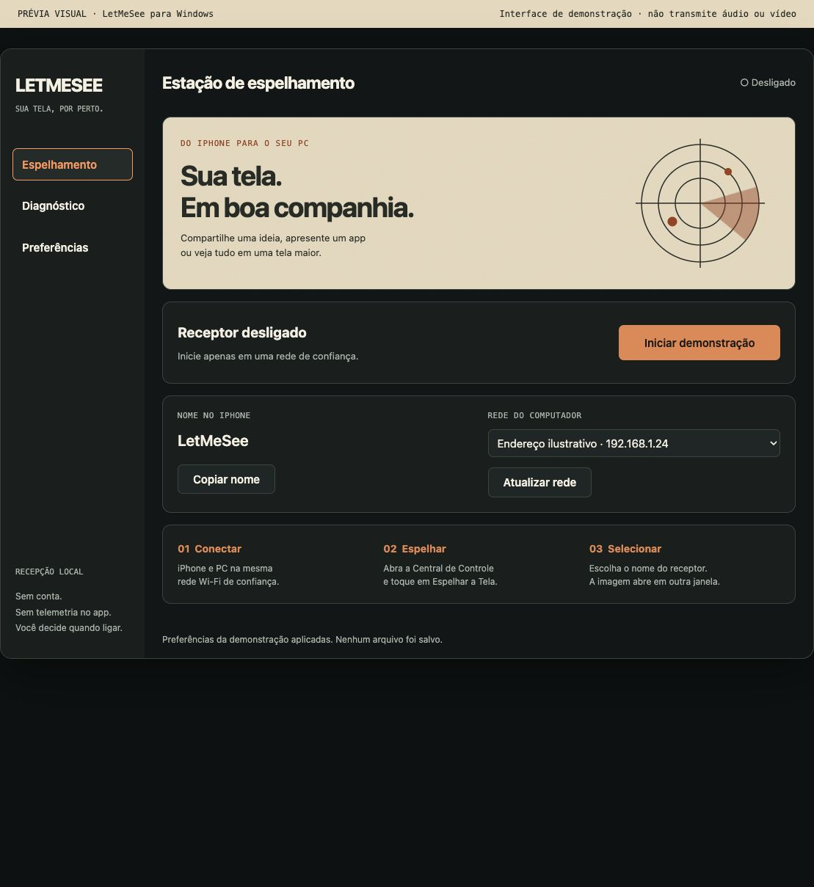

# LetMeSee

Espelhamento de **Android, iPhone e iPad** no **Windows ou macOS**, com preparação guiada antes de abrir a sessão. Depois do checklist, a tela principal tem somente duas ações: **Ambiente** e **Começar a espelhar**.

## Download para avaliação

A [pré-release 1.2.0-rc.1](https://github.com/francisco-efjr/LetMeSee/releases/tag/v1.2.0-rc.1) oferece o aplicativo compilado, sem precisar compilar o código no Windows. Baixe `LetMeSee-1.2.0-windows-x64-portable.zip`, confira o SHA-256 publicado e siga o `LEIA-ME-WINDOWS.txt` incluído. Extraia em uma pasta do seu usuário e abra `LetMeSee.exe`.

Esse pacote não inclui os motores de terceiros; o checklist orienta sua preparação explícita. É uma versão de avaliação sem assinatura de distribuição. As pendências de aparelhos físicos e instalador completo estão em [validação](docs/qa/VALIDACAO.md).



> A captura documenta a demonstração no navegador. Há aplicações nativas separadas: C#/WinForms no Windows e SwiftUI no macOS. As rotas Apple no Mac orientam o uso de recursos do sistema; não detectam ou controlam uma sessão Apple automaticamente.

## O que acontece ao abrir

1. O aplicativo identifica o sistema. Você escolhe o aparelho e a conexão; USB é a primeira opção no Android.
2. O checklist confere os recursos locais e mostra o que falta. As confirmações sobre celular, rede e privacidade ficam separadas dos resultados automáticos.
3. Corrija pendências e conclua a preparação. **Passo a passo** usa linguagem direta; **Detalhes técnicos** mostra informações adicionais. Ambos exigem os mesmos requisitos.
4. A tela principal fica simples: **Ambiente** para trocar/revisar a configuração e **Começar a espelhar** para iniciar o método escolhido.
5. Antes de iniciar, o aplicativo verifica os requisitos novamente. Trocar ambiente, parar/errar, suspender, observar mudança de rede ou passar cinco minutos invalida a preparação. Autorizações não são salvas como checklist concluído.

## Métodos disponíveis

| Aparelho → computador | Método | O que o botão faz |
| --- | --- | --- |
| Android → Windows | scrcpy por USB ou Wi-Fi já pareado | Confere o pacote, seleciona o aparelho autorizado e inicia a janela em visualização |
| Android → macOS | scrcpy/adb instalados e aprovados por você | Reconfere identidades locais e aparelho antes de iniciar |
| iPhone/iPad → Windows | AirPlay com UxPlay | Liga o receptor; você seleciona o nome em Central de Controle → Espelhar a Tela |
| iPhone/iPad → macOS | Receptor AirPlay do macOS compatível | Orienta a continuação no iPhone; a sessão pertence ao sistema |
| iPhone/iPad → macOS por cabo | Prévia do QuickTime | Abre QuickTime; você escolhe Nova Gravação de Filme e o iPhone como fonte, sem precisar gravar |

Android por USB funciona sem rede. Wi-Fi Android exige depuração sem fio do Android 11+ e pareamento anterior; o app não abre a porta 5555. AirPlay funciona sem internet, mas exige rede local, descoberta e permissões compatíveis. Conteúdo protegido pode mostrar tela preta. Áudio depende do dispositivo, versão e aplicativo.

No AirPlay Windows, um código de **pareamento** é gerado para a execução. A identidade do receptor é randomizada (`-m`). Isso não é promessa de um novo pedido de código em toda reconexão; a semântica de confiança do protocolo precisa ser testada com o dispositivo. Um processo ativo não é prova de vídeo recebido.

No Mac, o botão muda para **Concluir orientação** nas rotas Apple. Parar a orientação/fechar LetMeSee não encerra uma sessão AirPlay ou janela QuickTime: a própria interface explica onde parar.

## Windows 10/11 x64

Requer .NET Framework 4.8 e Windows PowerShell 5.1. A interface não precisa de administrador.

```powershell
.\build_ui.bat
.\iniciar.bat
```

O checklist oferece ações explícitas para preparar componentes:

- **Preparar Android…** baixa scrcpy 5.0.1 oficial, confere SHA-256, valida ZIP e gera inventário. O destino por usuário é `%LOCALAPPDATA%\LetMeSee\engines\android`, separado do AirPlay. Não executa adb/scrcpy durante essa preparação.
- **Preparar AirPlay…** usa o pacote fixado em `config/dependencies.json`. No instalador completo, esse runtime já vem preparado; em instalação corrompida/protegida, reinstale o pacote verificado.
- **Configurar descoberta…** é opcional e explícito: exige UAC, manifesto íntegro e assinatura Apple válida antes de abrir o instalador Bonjour para você concluir. Nunca acontece na inicialização.
- **Configurar firewall…** exige UAC e aplica apenas regras por executável/portas, perfil Privado e sub-rede local. A instalação não habilita acesso de rede sem opt-in.

Alternativa para preparar os motores manualmente:

```powershell
powershell -NoProfile -File .\scripts\download_deps.ps1
powershell -NoProfile -File .\scripts\prepare_android.ps1
```

Não eleve o download portátil. Drivers OEM, autorização RSA, políticas corporativas e alterações de rede são decisões do usuário/administrador; o aplicativo não as contorna.

## macOS 13 ou posterior

Use o Xcode/Command Line Tools já instalado para compilar o app nativo:

```sh
zsh apps/macos/test.sh
zsh apps/macos/build.sh
open apps/macos/build/LetMeSee.app
```

O aplicativo local compila na arquitetura do Mac atual. Para Android, selecione e confira sua instalação confiável de adb, scrcpy e scrcpy-server; não há instalação automática. A presença de macOS 13 não comprova suporte do hardware ao Receptor AirPlay. Se o recurso não estiver disponível ou não houver rede, escolha cabo/QuickTime.

Veja [o guia macOS](apps/macos/README.md). O build local não é um pacote assinado/notarizado para distribuição.

## Segurança e privacidade

Não há conta, telemetria ou gravação implementadas pelo aplicativo. Android usa visualização sem controle/clipboard e servidor ADB próprio em loopback; não encerra o servidor usado por Android Studio ou outros apps. PINs, checklist e serial escolhido não são persistidos.

No Windows, hashes do pacote e inventário são conferidos antes de executar. No Mac, a aprovação de caminhos/SHA-256 identifica arquivos locais, sem certificar a origem de toda a instalação. Hash não é auditoria de vulnerabilidades. A distribuição pública depende de testes físicos, assinatura e inventário de terceiros.

- [Métodos e fontes oficiais](docs/architecture/METHODS.md)
- [Cenários e critérios de aceite](docs/qa/SCENARIOS.md)
- [Como testar](COMO-TESTAR.md) e [evidências](docs/qa/VALIDACAO.md)
- [Segurança](SECURITY.md), [terceiros](THIRD_PARTY.md) e [design](docs/design/DESIGN.md)

## Estrutura

```text
src/Core/                # Seleção, requisitos e decisões do checklist Windows
src/Infrastructure/      # AirPlay, Android, integridade, rede e processos
src/UI/                  # Preparação separada da tela de duas ações
apps/macos/              # Aplicativo SwiftUI, domínio e testes nativos
scripts/                 # Preparação explícita de motores e configuração Windows
config/                  # Versões, origem e SHA-256 fixados
installer/               # Instalador Windows offline
tests/                   # Regressões do núcleo, matriz, pacotes e prévia
docs/                    # Métodos, cenários, design e evidências
```
